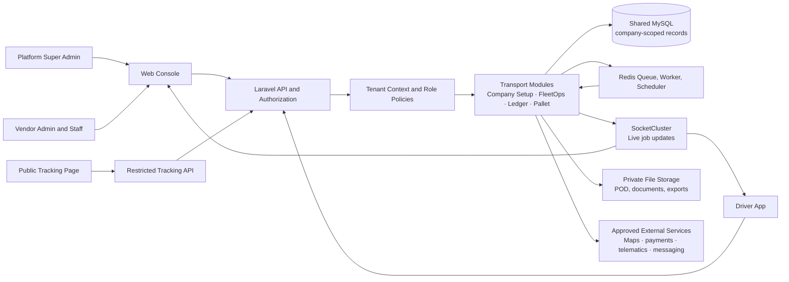
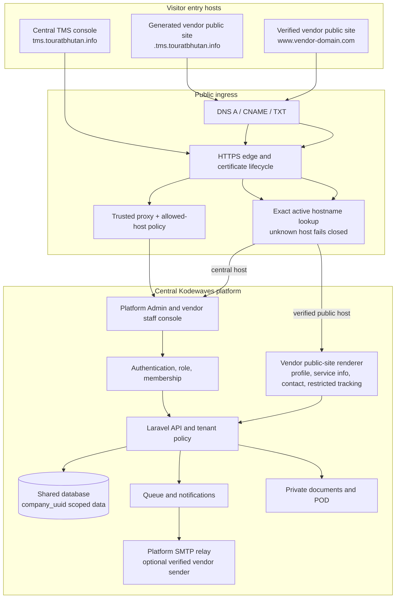
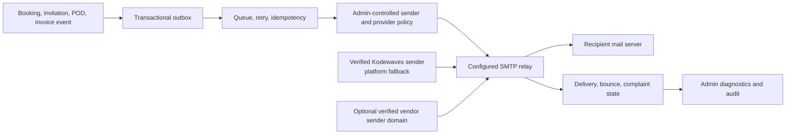
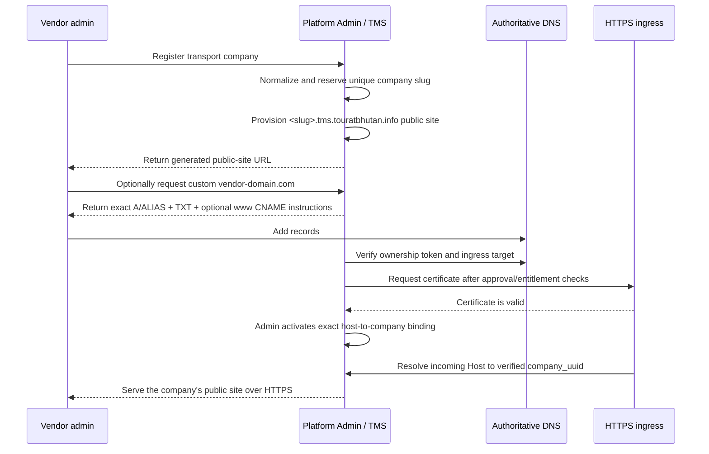
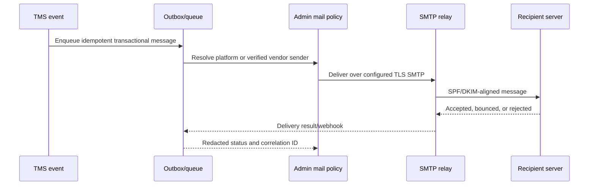
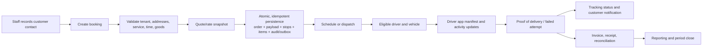

# Kodewaves TMS: End-to-End Completion Plan

**Prepared:** 6 November 2026  
**Status:** Audit and implementation roadmap; not a production-readiness certification  
**Brand for this document:** Kodewaves TMS

## 1. Purpose and agreed product boundary

This plan reconciles the current TMS source, the reviewed transport-management decks, the quotation, and the user's before-noon/yesterday requirements. It separates work that is already present in code from work that still needs implementation or proof.

The platform has three operational surfaces:

1. **Platform Admin:** the SaaS owner's controls for transport-company tenants, users, plans, entitlements, subscriptions, audit, support, and platform operations.
2. **Vendor workspace:** each transport company manages its own staff, contacts, bookings, fleet, drivers, operations, finance, and permitted warehouse features.
3. **Driver app:** drivers receive assigned work, update activities, navigate, and capture proof of delivery.

Customers are **company-scoped contact records**, not login accounts. Company staff create bookings on their behalf. There is no Customer Portal in the product. Public tracking may remain as a limited, read-only status view. The final reviewed decks also remove commerce/Storefront from the product scope.

Keep useful transport functions and operational data. Remove the wrong user-facing product experience—Fleetbase promotional branding, portal/commerce access, and the legal upsell popup—without deleting upstream source, data history, copyright statements, or license notices. The legal page must continue to expose the applicable AGPL text, copyright attribution, third-party notices, and corresponding source.

The seven quoted modules remain the scope baseline: SaaS Administration, Company Setup, Bookings & Dispatch, Fleet & Maintenance, Driver Mobile App, Finance & Reporting, and Warehouse & Stock. The quotation includes warehouse in the seven-module price; the decks describe it as optional per vendor. The implementation should preserve warehouse capability and use plan/entitlement gates to control which vendor tenants enable it.

**Separate brand request:** the requested brand name is **Transport Diary**. Logo/name ideation for Transport Diary is not part of this Kodewaves TMS implementation plan or client deck. The supplied PDF's filename contains “Daires”; that is only the source filename spelling.

## 2. Inputs and decisions captured

### Reviewed project inputs

- `Transport_Management_Final_Reviewed.pptx` (117 slides): role model, company-scoped contacts, staff-created bookings, dispatch and driver lifecycle, finance, platform security, and acceptance criteria.
- `DOC-20261031-WA0004.pptx` (144 slides): expanded version of the same scope, including FASTag/toll import and provider-dependent requirements.
- `Kodewaves_Quotation_Transport_Daires.pdf` (2 pages): seven priced modules, estimate and payment milestones, client inputs, acceptance window, support period, exclusions, and third-party costs.
- Qoder marketplace screenshot: Product Management (authorization needed), Product Design, Frontend Design, UI/UX Pro Max Skill, Design Review, Superpowers, and PPT. These are references shown by the screenshot; it does not establish that the extensions are installed or authorized in this Codex session.

### Design extension/repository lookup

- The other chat identified two repository references: [Impeccable](https://github.com/pbakaus/impeccable), which provides agent design/review guidance, and [Awesome Design Skills](https://github.com/bergside/awesome-design-skills), which is a registry of design `SKILL.md` / `DESIGN.md` folders. These are repository references, not proof of an existing local checkout or an installed extension.
- Reading the other chat's actual UI-work history confirms it did not use Qoder's design skills, Impeccable, Awesome Design Skills, or a motion extension for those UI edits. It hand-coded the other product's existing Next.js/Tailwind/CSS Modules theme. It sent the two repository links to this TMS chat as references; that is not evidence the repositories were installed or applied here.
- The shared Codex skills folder now contains Impeccable 4.8.0 at `C:\Users\Adarsh\.codex\skills\impeccable`; it is available to apply to this TMS work. The other chat's UI edits predated that install and did not use it. No `awesome-design-skills` checkout was found in the searched TMS/AI worktree and Codex skill roots; search the owner's known project roots before any use and do not create another clone. The marketplace labels in the supplied screenshot do not prove installation or authorization.
- The Qoder screenshot's names are separate from these repository links: Product Management is marked authorization-needed; Product Design, Frontend Design, UI/UX Pro Max, Design Review, Superpowers, and PPT appear listed. The screenshot alone does not confirm their actual installation/authorization here.

### Scope decisions

| Area | Plan decision |
| --- | --- |
| Customer Portal | Remove customer sign-in, self-service booking, and portal APIs from the shipped TMS. Preserve contact records, staff booking, notifications, and public tracking. |
| Storefront/commerce | Out of the TMS scope per the final reviewed decks. Disable from the product workflow; preserve source/history until dependency and license review is complete. |
| Fleetbase product branding | Remove product logos, sales links, promotional controls, Fleetbase default sender/product copy, and the screenshot popup. Retain legally required upstream attribution and source/licensing access. |
| Product theme | First implementation priority after source/config safety and error triage. Create a TMS-specific Kodewaves visual system using the available design skill as guidance; do not reproduce another Kodewaves application's layout or palette one-to-one. Apply it across public pages, sign-in/onboarding, Admin, vendor workspace, and driver-facing surfaces, including loaded logo/icon assets as well as component styles. |
| Public website and demo | User-added requirements beyond the quotation/decks. Public pages must be complete and accurate; demo access must be restricted and separated from production data. |
| Vendor subdomains and custom domains | Create a unique public-site subdomain automatically per vendor. Allow a verified vendor-owned custom hostname to bind only to that vendor's public company site. Keep Platform Admin and vendor staff console at the central TMS host. |
| SMTP and sender domains | Configure platform-managed transactional SMTP as the default. Allow optional vendor-branded sender domains only after DNS ownership and sender authentication checks, with platform-wide policy and Admin CRUD. This is outbound SMTP, not mailbox/IMAP hosting. |
| Currency | INR only for new transactions and configuration across the platform, company workspaces, driver app, invoices, and reports. Preserve existing records with their original currency and amounts; audit and resolve them explicitly before any conversion. |
| Extension use | Apply the verified global Impeccable 4.8.0 skill to UI work. Use its principles to make the TMS coherent and distinctive, not a one-to-one copy of another product. Reuse Awesome Design Skills only from an existing owner checkout if found; do not clone another copy. Product Management remains authorization-gated in the screenshot. |
| Commercial scope | The quotation's 40-day estimate begins after advance and receipt of all inputs. It is a commercial estimate, not evidence that the current code is complete. |

## 3. Current baseline: confirmed, incomplete, and unverified

### Confirmed in source or live read-only checks

- The vendor order form calls a real model save, and the internal API creates an order record; this is not a display-only mock by design.
- The application is a shared Laravel API / Ember console architecture. Company records share a MySQL database and rely on company membership and `company_uuid` scoping.
- FleetOps, Ledger, Pallet, and Navigator provide substantial transport, finance, warehouse, and driver surfaces.
- Public pages and the legal/source route respond on the live host. This confirms reachability only, not the correctness of login, booking, or business workflows.
- Existing source bundles are present. The supplied TMS directory is an extracted source snapshot without a root `.git` directory. The accessible Git worktrees checked are unrelated AI-platform repositories and must not be used as a substitute or edited.
- The `companies` schema already has a `slug` field, but the checked migrations do not define a tenant-domain registry or DNS/TLS verification lifecycle. Production compose pins `APP_URL`, `CONSOLE_HOST`, and the session host to `tms.touratbhutan.info`; it sets `MAIL_MAILER=log`, so the checked production configuration does not deliver SMTP mail.
- `TrustHosts` contains a wildcard-subdomain pattern test and middleware implementation, but the middleware is commented out of Laravel's global Kernel. That pattern does not verify or resolve a vendor-owned custom host to a company. The checked Caddyfiles serve internal HTTP listeners and do not implement tenant host routing, custom-domain verification, or public TLS issuance.
- The existing `docs/PLATFORM_COMPLETION_PLAN.md` also calls for centrally controlled domain/mail lifecycle. This plan carries forward that requirement while retaining the user's explicit no-Customer-Portal product boundary.

### Known gaps requiring implementation or direct proof

- The reported “order does not create” issue is not reproduced yet. The internal create request validates `dispatch`, while downstream creation reads `order.dispatched`; related order writes are not covered by a single transaction. These are real defects, but neither alone proves the user's reported symptom.
- Existing code exposes portal entry points: `/auth/portal`, the Customer Portal console/API packages, and FleetOps customer self-service routes. A marketing-only hide is insufficient.
- Public copy has since been updated on `https://tms.touratbhutan.info`; the live legal route and source download are reachable. Browser checks also confirmed the updated sign-in and branding. This is reachability and visual evidence only; booking, demo isolation, and all panel workflows remain unverified.
- The demo account requested by the owner is not present in the source inventory.
- The legal-notice component contains Fleetbase sales copy and outbound promotional links. Its runtime popup trigger has not yet been located; trace the trigger before claiming the popup is fixed.
- Theme quality across every panel has not been proven. Native mobile builds, complete DB-backed workflows, and production acceptance remain open in `docs/WORK_STATUS.md`.
- The other chat's UI-work history confirms its UI edits were hand-coded and did not use the listed design references. Impeccable 4.8.0 is now present in the shared `.codex/skills` folder and is being applied to TMS design work. The owner's `awesome-design-skills` checkout has not yet been located; no clone has been made.

## 4. Proposed architecture and data-flow map

The printable four-panel graphic is [Kodewaves_TMS_Domain_Mail_Architecture_Map.svg](./Kodewaves_TMS_Domain_Mail_Architecture_Map.svg). It visualizes the central-vs-vendor host boundary, DNS records, ownership/TLS lifecycle, and SMTP sender flow shown below.

### Target logical architecture

This map distinguishes the current shared-database tenancy model from the security work required to prove it. Every API request, export, upload/download, queued job, socket event, and driver sync must carry and enforce the correct company context. Public tracking must return only the limited tracking projection and must not grant a customer account or access to a vendor workspace.

### Vendor public-site domain architecture

**Confirmed domain consistency requirement:** one shared application deployment serves all vendors. Assigning a custom domain does not create another codebase, application folder, database, or copy of the vendor settings. The generated subdomain and verified custom domain resolve to the same company record, approved public content, branding/theme, and tracking policy. Changes to that company's public content appear on both hosts. Vendor-specific uploaded assets remain company-scoped within shared storage. Public-page caches must include the resolved company identity, and a primary-domain redirect policy must preserve working tracking links.

**What runs on the vendor's domain:** a branded, public company site only. It can display the vendor's approved public profile/service information, contact details, and a restricted order-tracking view. It does not host a separate TMS installation, staff workspace, customer accounts, customer self-service portal, or private vendor data. Vendor staff sign in at the central `tms.touratbhutan.info` host; role/membership checks choose the company workspace. Platform Admin remains the authority for every tenant and domain record.

**Automatic vendor subdomain:** at company registration, normalize the company name into a DNS-safe slug, reserve it uniquely, and provision `<slug>.tms.touratbhutan.info` as that company's default public-site address. A wildcard DNS record sends `*.tms.touratbhutan.info` to the public ingress; the host resolver maps only a provisioned slug to its `company_uuid`. Slug collisions receive a stable suffix. Reserved platform names are rejected. A slug rename is an audited Admin action and keeps a safe redirect/alias so that existing links do not silently change owners.

**Vendor custom domain:** the vendor requests a hostname (for example `vendor-domain.com`) from the central workspace. The platform returns exact DNS instructions: A/ALIAS to the public ingress IP for the apex, an optional `www` CNAME, and a unique TXT verification token. DNS pointing to the VPS is not proof of ownership. The platform waits until authoritative DNS returns the token, the host resolves to the expected ingress, an Admin policy/entitlement allows it, and HTTPS certificate issuance succeeds. Only then does Admin activate an exact hostname-to-company binding. The same public site renders for the generated subdomain and the custom domain. Unknown, duplicate, pending, expired, suspended, or removed domains never fall back to a default tenant.

**TLS and edge ownership:** the production ingress/reverse-proxy owner must be identified and made responsible for host allowlisting, certificate issuance/renewal/revocation, and forwarding the original host only from trusted proxies. The checked repository Caddyfiles are internal HTTP listeners; they do not prove that arbitrary custom domains can be routed or issued certificates today. Wildcard certificates require DNS-01 or an equivalent supported certificate service. Each custom domain needs its own verified certificate unless a managed edge provides and demonstrates another supported approach.

**Session and data boundary:** keep staff authentication on the central host with host-only secure session cookies. A public custom-domain site gets no staff session and no cross-domain login cookie. Public APIs on these hosts expose only allowlisted company public fields and opaque tracking references, rate-limited and protected against enumeration. All private TMS APIs, files, reports, sockets, exports, and queued work continue to derive tenant scope from authenticated membership, never from an arbitrary request hostname or client-supplied `company_uuid`.

#### Email and SMTP architecture

Configure a real platform-managed SMTP relay as the reliable default before enabling vendor branding. The SMTP hostname/port/TLS/authentication settings are separate from the From-address domain. Store credentials only in encrypted server-side secret storage; the browser receives status and redacted diagnostics only. SPF authorizes the relay, DKIM signs messages, and DMARC provides a visible alignment policy. Optional vendor sender identities remain pending until provider-issued DNS records validate. Until verification, send from the platform address and use the vendor's contact as Reply-To where appropriate. Admin controls providers, limits, credentials, test sends, activation/suspension, fallback, retries, suppression, and diagnostics; each action is audited. This scope provides outbound transactional email, not vendor mailboxes, inbound MX hosting, IMAP, or a webmail product.

#### Domain data and control model

Use separate records for web host routing and email sender verification; validating a web-domain TXT claim does not authorize mail sending. Recommended tenant-domain fields: normalized unique hostname, `company_uuid`, generated/custom type, primary/canonical flag, status, proof token hash and expiry, last DNS result, certificate state and expiry, request/approval actors, plan entitlement, timestamps, soft-delete and audit metadata. Recommended sender-domain fields: `company_uuid`, normalized email domain, provider reference, allowed From identities, SPF/DKIM/DMARC check states, verification timestamps, suppression/health status, and audit metadata. Keep secret values in an encrypted secret store and store only opaque secret references in application rows.

| Lifecycle status | Meaning | Who may cause the transition |
| --- | --- | --- |
| `requested` | Vendor/Admin submitted a domain claim; nothing is routed yet. | Vendor requests; Admin may create on a vendor's behalf. |
| `dns_pending` | Exact TXT/A/CNAME guidance has been issued; ownership/routing has not passed. | System enters after validation. |
| `verified` | Domain ownership and expected DNS target are confirmed. | System records evidence; Admin reviews exceptions. |
| `certificate_pending` | Host claim approved; HTTPS certificate is being issued. | System/edge automation. |
| `active` | DNS, policy, binding, entitlement, and HTTPS checks pass. | Admin activation after automated checks. |
| `suspended` / `expired` | Do not serve the tenant site on this host; preserve the audit record and generated subdomain. | Admin, policy, renewal monitor. |
| `removed` | Binding is retired; hostname cannot be reused by another tenant until a safe cooldown/ownership process completes. | Admin, with audit and cache/certificate cleanup. |

Vendors may request a hostname, see copyable DNS instructions and status, and request re-check/removal. Super Admin has global CRUD, verification override, approval, suspension, reactivation, removal, quota/entitlement, certificate/provider diagnostics, sender policy, and audit. Vendor users can only act on their own `company_uuid`; custom host requests cannot change who owns the hostname or the associated tenant.

#### Registration and custom-domain sequence

#### Email sender and delivery sequence

### Booking-to-finance workflow map

## 5. Detailed delivery work packages

### Phase 0 — Safe source and release baseline

- Record the source snapshot, package/submodule bundles, current remote deployment version, build inputs, runtime versions, migrations, queue/socket health, and rollback reference.
- Continue with the supplied source; locate the owner's existing design checkout via the other chat. Do not clone another repository and do not modify the unrelated `newai` projects.
- Build a route/module/role inventory and label each item **implemented**, **incomplete**, **broken**, or **externally blocked**.
- Preserve all source bundles, license files, client data, and unrelated VPS files.

**Gate:** known source and deployment baseline, no accidental secret disclosure, rollback path identified, no unrelated project modified.

### Phase 1 — Full product theme, public site, and error cleanup

- Verify the actual design references and local checkout status; do not clone a substitute.
- Replace the thin public landing page with complete and accurate product pages for roles, staff-created orders, modules, vendor domains, demo access, contact, and legal notices. Use the Kodewaves brand assets and one responsive visual system throughout.
- Remove upstream promotional branding and controls while retaining copyright, AGPL, third-party notices, and corresponding-source links.
- Apply the theme to public, auth, Admin, vendor, driver, data-table, form, dialog, notification, navigation, and map surfaces in both light and dark modes.
- Eliminate raw JSON/object output in API, validation, notification, and async error surfaces; retain diagnostic details in logs.
- Render and review representative public, auth, Admin, vendor, and driver pages at desktop and mobile widths.

**Acceptance:** all public product pages and representative role panels use the Kodewaves identity; no raw object/JSON is shown for common API failures; keyboard, contrast, mobile layout, and reduced motion are reviewed.

### Phase 2 — Booking creation and core dispatch

- Reproduce the actual staff-created booking flow and capture the sanitized POST response, persisted row state, and queue result.
- Correct confirmed request/model field mismatches; persist order, payload, stops, items, attachments, quote/rate snapshot, initial activity, audit event, and outbox work atomically.
- Add idempotency so browser retries and duplicate submissions return the original booking instead of creating duplicates.
- Validate customer/contact, order config, pickup/dropoff or waypoint set, service area, goods/dimensions, time window, files, driver/vehicle compatibility, and tenant ownership.
- Complete list, detail, schedule, route planning, dispatch, manifest publication, driver receipt, status transitions, exception/reattempt, cancellation/return, and proof capture.

**Acceptance:** a booking exists exactly once after submission; invalid/cross-tenant inputs are rejected; retries do not duplicate; assigned drivers receive only eligible jobs; activity/POD completion produces one downstream financial effect.

### Phase 3 — SaaS Admin, vendor setup, and tenant access

- Complete Super Admin vendor/company CRUD and lifecycle, user controls, plan/version management, entitlements, subscription states, usage, audit, support access, and platform diagnostics.
- Complete vendor company profile, staff invitations, role grants/revocation, contact records, service areas, depots, rate/workflow setup, and onboarding recovery.
- Use audited suspend/archive/restore for records referenced by bookings, invoices, or history; avoid destructive deletion that breaks financial records.
- Verify role enforcement in API as well as navigation, exports, files, queued work, and sockets.

**Acceptance:** role/action matrix passes for allowed and denied operations; cross-company reads/writes/exports/socket subscriptions fail safely; retries of provisioning do not create duplicate tenants or invitations.

### Phase 4 — Fleet, driver, and warehouse operations

- Complete vehicles, fleets, driver profiles, shifts/availability, maintenance, inspections, fuel, telematics handoff, assignment constraints, and historical retention.
- Complete Navigator authentication, assigned jobs/manifests, navigation, activity updates, proof methods (photo/signature/QR as specified), GPS/time capture, offline queue/replay, and conflict recovery.
- Implement warehouse receiving, putaway, reservations, picking, packing/loading, transfer, count, and returns. Enable per vendor entitlement while preserving the quoted module.
- Complete FASTag/toll statement import, vehicle mapping, transaction allocation, dispute handling, and reconciliation. Automatic issuer sync/recharge remains blocked until an authorized provider contract and credentials exist.

**Acceptance:** concurrency cannot reserve one driver/vehicle twice; driver access is assignment-scoped; offline retries preserve history; stock cannot oversell; duplicate import rows and repeated driver completion have one effect.

### Phase 5 — Finance, reporting, and integrations

- Snapshot approved booking charges/rates; issue numbered invoices/PDFs; record receipts and partial allocations; reconcile gateway settlements; separate credits/refunds; complete driver earnings/payout states and period reports.
- Verify webhook signature, tenant ownership, idempotency, ordering, and safe replay for each approved payment integration.
- Gate maps, telematics, messaging, gateway, and FASTag automation on client/provider access. Keep manual workflows usable when a provider is unavailable.
- Make failures actionable in the UI and diagnosable by Admin with a correlation ID; do not expose raw exception JSON, credentials, or stack traces.

**Acceptance:** duplicate/out-of-order events create one receipt/invoice effect; balances reconcile; exports are tenant-scoped; recovery/replay is auditable.

### Phase 6 — No-portal boundary, public pages, demo, and legal experience

- Remove `/auth/portal`, Customer Portal engine/API routes, FleetOps public customer sign-in/self-service booking routes, and their customer-login UI controls from the shipped product.
- Remove Storefront/commerce from the shipped transport workflow. Keep upstream source and legal provenance until dependency removal is complete and reproducible.
- Preserve public tracking as a limited read-only capability; keep customer contact and staff notification flows intact.
- Finish Home, About, Capabilities, Contact, Sign-in, Legal, and public Tracking pages with accurate Kodewaves TMS scope. Remove portal/commerce claims and ensure every link works.
- Create a restricted demo tenant/account with synthetic sample data. Keep credentials outside source, prevent access to production data, and disable write/admin actions unless the owner explicitly enables them.
- Remove Fleetbase logo, promotional modal/upsell links and Fleetbase product copy. Keep complete license text, copyright/source notices, and third-party attributions reachable from the application and public legal page.

**Acceptance:** portal login/API is unavailable; there are no customer account forms; staff can still create bookings for contacts; public tracking remains read-only; demo data is tenant-isolated; legal/source links return the correct files.

### Phase 7 — Vendor subdomains, custom domains, and SMTP mail

- Add separate web-host and sender-domain records, unique normalized host constraints, ownership/verification state transitions, Admin audit, and plan limits. Do not treat a web-domain TXT check as authorization to send email.
- On vendor registration, normalize the company name into a DNS-safe, reserved-name-checked slug; allocate it with a unique database constraint and provision `<slug>.tms.touratbhutan.info`. Keep the platform Admin/vendor console on `tms.touratbhutan.info`.
- Configure wildcard DNS at the actual ingress for generated vendor hosts. Implement safe host parsing/normalization, trusted-proxy configuration, exact active hostname resolution, and fail-closed behavior for unknown, duplicate, pending, expired, or suspended hosts.
- For vendor custom domains, provide exact A/ALIAS, optional `www` CNAME, and one-time TXT ownership instructions. Poll/recheck authoritative DNS, validate that traffic reaches the approved ingress, require Admin activation/entitlement, and issue/renew/revoke HTTPS certificates before the host goes live.
- Render only the bound company's public profile/service/contact pages and restricted tracking projection on vendor domains. Block staff/admin routes, session cookies, private APIs and vendor data on these public hosts. No Customer Portal, customer login, or customer self-service order creation is added.
- Configure a working platform SMTP relay as the default sender. Implement queued transactional delivery with bounded retry/idempotency, redacted delivery state, bounce/complaint handling, and Admin test/health controls. Keep SMTP secrets encrypted server-side.
- Allow an optional vendor From domain only after SPF/DKIM and domain ownership checks. Show DMARC guidance and provider-specific DNS values. Until verified, use the Kodewaves sender and the vendor contact as Reply-To where appropriate. This scope does not create mailboxes, inbound MX, IMAP, or webmail.

**Acceptance:** registration creates one unique vendor public-site subdomain; custom domains remain inactive until ownership, routing, policy, and HTTPS are valid; the exact host resolves only to its bound company; unknown hosts fail closed; Admin can create/review/verify/approve/suspend/reactivate/remove every domain; vendor users can only request/manage their own records; the staff console stays central; delivery succeeds through configured SMTP with platform fallback; unverified vendor senders cannot spoof From; retries are idempotent and Admin can diagnose delivery failures.

### Phase 8 — Production acceptance and handover

- Build immutable artifacts from the reviewed source, apply migrations to a staging copy, validate backups and restore, and record dependency/security results.
- Verify TLS, private database/cache access, queue/socket health, storage permissions, secrets, monitoring, rate limits, and rollback before deployment.
- Run the agreed Admin → vendor → booking → dispatch → driver → POD → finance/warehouse acceptance scenarios against the deployed version using synthetic data.
- Hand over source, version, setup/runbook, demo-access method, known provider dependencies, rollback point, and acceptance evidence.

**Acceptance:** all must-have flows pass on the exact deployed build; critical/high data-integrity or security findings are closed; backup/restore and rollback are demonstrated. Do not label the platform production-ready before this gate.

## 6. Verification matrix

| Area | Required evidence |
| --- | --- |
| Booking create | UI/API/DB integration; duplicate retry; partial-write rollback; clear validation; tenant ID rejection |
| Dispatch and driver | eligible assignment; exclusive reservation under concurrency; driver sees only assigned manifest; offline replay |
| POD and finance | required proof; duplicate completion produces one invoice/charge; quote snapshot matches invoice |
| Tenancy and roles | cross-company API/UI/export/upload/socket denial for Admin, vendor staff, and drivers |
| Warehouse | receiving-to-return lifecycle; concurrent reservation; no oversell; audit history |
| Payments/imports | duplicate and out-of-order webhook/import idempotency; invalid signature rejected; replay is safe |
| Portal removal | no portal route/login/API or customer self-service booking; contact/staff booking/tracking still work |
| Public/demo/legal | public routes and navigation; demo isolation; legal/copyright/license/source files accessible |
| Vendor host routing | generated slug uniqueness; wildcard DNS/HTTPS; verified custom host maps to exactly one company; unknown/pending/suspended host fails closed; no console/session exposure |
| Domain administration | vendor-scoped request/status; Super Admin CRUD, approval, entitlement, suspend/remove, DNS/TLS expiry monitoring, audit trail |
| SMTP mail | production SMTP test and end-to-end invite/booking/POD/invoice send; secret redaction; queue retry/idempotency; bounce/error status; platform fallback |
| Sender-domain verification | provider SPF/DKIM values validated; DMARC guidance; unverified From blocked; verified vendor sender still uses central policy and relay |
| Theme | all panels and role states; desktop/mobile; contrast, keyboard and reduced motion |
| Release | artifact digest, migration head, backup/restore, queue/socket health, rollback and live acceptance evidence |

## 7. Commercial assumptions and external dependencies

The quotation lists a total of **₹150,000** for the seven modules, an estimated **40 days after advance and receipt of required inputs**, and **50% advance / 50% before go-live and final handover**. It also states that third-party/domain/hosting/service costs are paid by the client, provides two revision rounds per milestone, seven days for acceptance testing, and 30 days of post-go-live bug-fix support. The quotation's exclusions include data migration, content/legal documentation, security certifications, and a technology rewrite. Confirm these terms against the signed quotation before treating them as a delivery commitment.

External dependencies include client-provided organization branding, rate rules, workflows, sample data, approved payment/messaging/map/telematics credentials, and hosting access. Provider-gated features must stay visibly unavailable or manual until those inputs are approved.

## 8. Source traceability

- Quotation scope/commercial basis: `Kodewaves_Quotation_Transport_Daires.pdf`, pages 1–2.
- Roles, contacts, order lifecycle, driver/POD, finance, tenant security and acceptance: `Transport_Management_Final_Reviewed.pptx`, slides 3–4, 10–21, 26, 31, 42, 55, 63, 66, 80, 114–117.
- Expanded FASTag, recovery and final no-portal/no-commerce scope: `DOC-20261031-WA0004.pptx`, slides 3–4, 10–21, 26, 31, 42, 55, 63, 66, 77, 86, 96, 114, 119–129, 141–144.
- Current implementation paths: `console/app/router.js`; `packages/fleetops/server/src/routes.php`; `packages/fleetops/server/src/Http/Controllers/Internal/v1/OrderController.php`; `packages/fleetops/server/src/Http/Requests/Internal/CreateOrderRequest.php`; `apps/navigator-app`; `packages/ledger`; `packages/pallet`; `docker-compose.yml`; `docs/WORK_STATUS.md`.
- Domain/mail baseline: `packages/core-api/migrations/2023_04_25_094305_create_companies_table.php` (`companies.slug`); `api/app/Http/Middleware/TrustHosts.php`; `api/app/Http/Kernel.php` (middleware commented out); `api/tests/Unit/Http/Middleware/TrustHostsTest.php`; `docker-compose.production.yml` (fixed central host and `MAIL_MAILER=log`); `Caddyfile`, `Caddyfile.console`; `packages/core-api/src/Http/Controllers/Internal/v1/SettingController.php`; `console/app/components/configure/mail.js` and `.hbs` (global SMTP settings UI).

## 9. Execution order

0. Reconcile source, recover the existing design extension checkout without cloning, and capture a reproducible baseline.
1. Complete the Kodewaves theme across public pages, sign-in/onboarding, Admin, vendor, and driver surfaces; resolve structured errors.
2. Reproduce and repair booking creation; complete dispatch-to-POD-to-finance.
3. Finish Admin/vendor roles, CRUD, plans, entitlements, and tenant isolation.
4. Finish driver, fleet, warehouse, finance, and provider-gated workflows.
5. Enforce the no-Customer-Portal/no-commerce boundary; finish public/demo/legal experience.
6. Complete vendor subdomains/custom domains and Admin-controlled SMTP delivery.
7. Verify complete panels and cross-role workflow acceptance.
8. Complete production acceptance, controlled deployment, rollback evidence, and handover.

No feature is called complete because its screen exists. Each phase closes only when its stated acceptance evidence is available.

## 10. Live release evidence — 6 November 2026

- The live host is `https://tms.touratbhutan.info`; SSH deploy access is available and the deployed Compose stack is under `/www/wwwroot/tms.touratbhutan.info`.
- The live Home, Services, Legal, sign-in, Fleet Ops SPA route, and tracking SPA route returned HTTP 200 in checks on 6 November. The public pages use the Kodewaves route mark and forest/ivory theme. A browser render verified the sign-in layout, visible email/password labels, tracking action, and open-source notice link; no browser errors were recorded.
- Console runtime manifest loads eight extensions: AI, Developers, Fleet Ops, IAM, Ledger, Vroom, Valhalla, and Registry Bridge. Customer Portal and Storefront are disabled in the console extension manifest. Their dependency packages, backend packages, route files, and some login/router references remain; runtime-manifest exclusion alone does not prove complete removal.
- Production console runtime config uses the central HTTPS API host and secure SocketCluster on port 443. Production compose remains configured with `MAIL_MAILER=log`, so SMTP delivery is not live. Production pins the central host; vendor DNS/TLS/domain lifecycle is not implemented.
- The source now defaults to the light Kodewaves theme. A parallel full Ember build stalled on Windows before producing a new bundle; the light sign-in appearance was delivered through versioned runtime theme CSS and visually verified live. The stalled build is not build evidence.
- A rollback snapshot of the previous console `index.html`, stylesheet, and public site is saved under `/www/wwwroot/tms.touratbhutan.info/releases/ui-20261106-theme1/backup`. The current live stylesheet is `/kodewaves-theme-20261106e.css`. The console serves the staged release through a read-only Compose bind mount; it was recreated and the live sign-in and logo were verified afterward. The previous Compose configuration is saved beside the rollback snapshot.
- Remaining evidence gaps include end-to-end order creation against production-like data, tenant boundaries across API/export/file/socket paths, demo credentials and isolation, real SMTP delivery, vendor-domain provisioning/custom TLS, mobile driver acceptance, dependency security, and backup/restore/rollback drills.

## 11. Follow-up correction — original panel structure — 6 November 2026

- The root source bundle's archived snapshot `8b8dcd38b8e564e6409dd0bb036d5bdc36c5900f` contains the original `console/app/templates/console/home.hbs` and `console/app/templates/console/admin/index.hbs`. Both working files were restored from that snapshot and compared byte-for-byte after normalizing line endings. The original `Dashboard`, extension yield hooks, and spacer remain; the later-added workspace intro panels are removed.
- The Route Atlas theme remains a CSS-only treatment for the existing panel components. Its unused workspace-intro CSS was removed. The 1040px header fit and extension popup were verified live in the preceding check.
- The active live console still uses its already-compiled JavaScript. A versioned CSS bridge (`kodewaves-theme-20261106j.css`) hides the two stale intro DOM blocks until a clean bundle can replace them. The stage3 index was backed up as `backup/index.before-original-panel-bridge.html`; `/auth` and the versioned stylesheet return HTTP 200. The authenticated dashboard was checked in-browser: the intro is hidden, while Default Dashboard and the original widgets remain visible.
- A clean production Ember build was attempted with `pnpm exec ember build --environment=production --output-path ../.codex-build/restored-panels-dist`. Extension generation completed and discovered the expected eight extensions, but asset compilation did not produce a `dist` directory; the process was stopped after it stalled without further output. Do not treat the bridge as a clean production bundle or claim the full build passed.
- Focused Ember template lint passes for both restored templates. Stylelint on `console/app/styles/kodewaves-theme.css` still reports 227 findings, including duplicate selectors and specificity ordering; these are outstanding stylesheet cleanup, not a clean lint result.
- The live dashboard still displays `$0.00` in financial widgets. INR-only formatting/defaults are therefore not complete. The production companies table currently contains one null currency and one `BTN` currency; no company or transaction rows were changed during this correction.
- No dashboard, vendor, or Admin feature was removed. This corrects only the added introductory layout markup and its unused styling. The clean bundle, INR-only treatment, complete style-lint cleanup, and the other Phase 0–8 acceptance items remain open.
