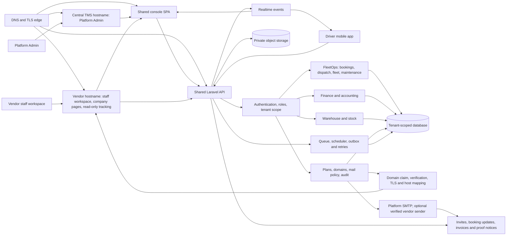

# Kodewaves TMS platform audit and completion plan

Status: working plan based on the reviewed product materials and the current checkout. This is not a production-readiness certification.

## Product boundary

- The SaaS owner operates a Super Admin surface for transport-company accounts, plans, subscriptions, usage, support, and platform operations.
- Each transport company is a vendor tenant with its own staff, roles, customer-contact records, bookings, fleet, drivers, operations, and financial records.
- Super Admin owns platform-wide configuration and CRUD for vendor organizations, users, plans, entitlements, domains, mail policy, subscriptions, support, and operational controls. Vendor users administer only their own transport-company data and staff.
- A vendor may map a verified custom domain to its own company workspace and permitted branded public/tracking surfaces. A plan-eligible vendor subdomain is provisioned during registration. Both hosts use the same centrally managed deployment and tenant boundary; no separate vendor codebase is created.
- Mail works by default through platform-managed transactional delivery. A vendor may optionally connect a verified sending domain/provider; Super Admin retains global provider policy, limits, diagnostics, and override controls. Sender-domain verification must cover SPF/DKIM and show actionable DNS records and delivery health.
- Drivers use the assigned driver app for jobs, manifests, navigation, activity updates, delivery proof, inspections, and offline work.
- Customers are company-scoped business/contact records. Staff create bookings for them and send documents or notifications. This delivery has no customer portal, customer login, or customer self-service workflow. Keep customer contact records and public order tracking where authorized; do not expose portal navigation, routes, credentials, or portal engine assets in the shipped build.
- Warehouse/inventory is included in the quotation's seven priced modules. It may be entitlement-gated per vendor, but it is not a Customer Portal and is not silently removed from the scope.
- Subcontracted carrier workflows are optional staff-managed operations. The base product does not provide a carrier portal.
- FASTag statements/import and vehicle/trip cost reconciliation are specified in the expanded product brief. Automatic issuer synchronization or recharge must wait for an authorized provider contract and credentials.

## Architecture map

The target is one shared application and API with tenant-scoped records. A vendor domain or platform subdomain maps to that vendor's workspace and permitted public/tracking surfaces in the same deployment. Platform Admin controls provisioning, host claims, TLS and mail-provider policy. Company users and drivers authenticate through their own scoped clients. Customer contacts are data in a vendor workspace; there is no customer account surface.

This is the intended ownership/data flow, not proof that every arrow is production-complete. The phase gates below identify the runtime evidence still required.

## Source material

- `E:\Downloads\Kodewaves_Quotation_Transport_Daires.pdf`: seven priced modules (SaaS Administration, Company Setup, Bookings & Dispatch, Fleet & Maintenance, Driver Mobile App, Finance & Reporting, Warehouse & Stock), ₹150,000 total with 50/50 payment milestones, and third-party/provider dependencies. Customer Portal is explicitly an extra-cost option.
- `E:\Downloads\Transport_Management_Final_Reviewed.pptx`: 117-slide feature specification, including three panels, booking-to-reconciliation lifecycle, tenant isolation, FASTag, warehouse, architecture, security and acceptance sections.
- `E:\Downloads\DOC-20261031-WA0004.pptx`: 144-slide expanded version. It states customers are contacts rather than login accounts, and calls for tenant-scoped roles, idempotent booking creation, quote snapshots, dispatch constraints, proof, finance and recovery controls.
- `C:\Users\Adarsh\Pictures\Screenshots\Screenshot 2026-10-27 162052.png`: shows seven installed design/product references: Product Management (authorization needed), Product Design, Frontend Design, UI/UX Pro Max Skill, Design Review, Superpowers, and PPT. The screenshot alone does not prove all are authorized or usable in this thread.

## Current checkout evidence and risks

- This checkout has no root `.git` directory, so normal branch/diff provenance is unavailable. Preserve source bundles and verify the active VPS directory before replacing code.
- The repo contains local packages for FleetOps, IAM, Developer tools, Ledger, Storefront, AI, Registry Bridge, Valhalla/VROOM, Pallet, and `customer-portal`.
- `console/fleetbase.extensions.json` disables `@fleetbase/customer-portal-engine` and `@fleetbase/storefront-engine`, and the live runtime extension list omits both. A fresh inspection found Storefront still in the live HTML asset manifest; its removal from the build remains open. The API retains optional package sources/declarations for provenance, while Laravel auto-discovery is disabled for `fleetbase/customer-portal-api` and `fleetbase/storefront-api`. The customer self-service route cleanup is deployed; staff-managed customer contacts, lookup, bookings, notifications, and authorized public tracking remain. Downstream dispatch and proof of delivery are not yet verified.
- Custom vendor domains and tenant-specific email senders need an explicit audit before implementation: verify ownership, route the vendor's own panel and permitted company-facing surfaces to its tenant, issue/renew TLS, preserve tenant isolation, and keep global domain/provider policy under Super Admin. Vendor subdomains should be provisioned during registration according to the assigned plan. Do not equate a DNS A record pointing at the VPS with completed ownership or a published vendor site.
- `docs/WORK_STATUS.md` contains stale claims that no live host exists alongside historic source/test notes. Do not use that document as current deployment evidence.
- Prior turn's live deployment claims are not sufficient evidence for end-to-end readiness. Recheck the current VPS project, image digests, extensions, routes, schema/migrations, logs, and browser interactions before deployment.

### Current reconciled baseline (2026-11-08)

- The browser-visible platform is live at `https://tms.touratbhutan.info`. The active console container bind-mounts `/www/wwwroot/tms.touratbhutan.info/releases/ui-20261106-theme3/console-stage` read-only. The root route redirect, profile-menu cleanup, customizer stylesheet, no-portal distribution, and dashboard INR formatting are deployed there. The public `/legal` page remains reachable. The current console backup is stored under that release's `backup/` directory. HTTP checks and a desktop browser session prove the console shell and selected overlays render; they do not prove authenticated order creation or every panel works.
- The root checkout has no `.git` directory. The preserved `git-bundles/root.bundle` advertises `main` at `67b2db64c7490599aaa6c799b26d5e4de897c25` and `transport-erp-custom` at `8b8dcd38b8e564e6409dd0bb036d5bdc36c5900f`. An earlier task note reports a separate `Fleetbase ERP Customization` conversation with a Library ZIP at `c461a6f` and 14 submodule bundles, but fresh Codex thread-history inventory on 2026-11-08 returned no thread with that title or `awesome-design`; no Library download tool is exposed in this task. The refs do not establish that the ZIP and current checkout are identical. Continue using this existing checkout and its preserved bundles; do not clone another tree or claim Git commit history that is not present.
- Rechecked the local source archive `E:\ai\aagent\tms\Kodewaves-TMS-source-2026-11-05.zip` (111,839,145 bytes, 18,788 entries). Its `git-bundles/root.bundle` is byte-for-byte identical to this checkout's bundle, confirming the same source-history base. Its current UI/router/package files differ from this checkout, it has no `.impeccable/` design references, and it omits `console/fleetbase.extensions.json`; it is an older source snapshot, not the missing `c461a6f` Library artifact. The app's Codex thread history exposes no `Fleetbase ERP Customization` or `awesome-design` thread, and local `E:\ai`/attachment inventory contains no matching checkout or archive. The external chat's package/plugin list therefore remains unverified; do not substitute guesses for it.
- The screenshot's design references can be matched to installed local skills only in part: `impeccable` and `ui-ux-pro-max` are present; Product Management in the screenshot is marked authorization-needed. Product Design, Frontend Design, Design Review and Superpowers were not found in the installed skill/plugin cache. This repo already contains `.impeccable/` Route Atlas research, mockups and decision payloads, so no separate design repo is required for current implementation. The exact external `awesome-design` checkout was not located in the available chat summaries or local `E:\ai` directories.
- The live `/extensions.json` currently exposes eight application engines: `@fleetbase/ai-engine`, `@fleetbase/dev-engine`, `@fleetbase/fleetops-engine`, `@fleetbase/iam-engine`, `@fleetbase/ledger-engine`, `@fleetbase/registry-bridge-engine`, `@fleetbase/valhalla-engine`, and `@fleetbase/vroom-engine`. Customer Portal and Storefront are absent from the live list. This is the runtime extension inventory, separate from the screenshot's design skills; it does not establish which external plugins the other chat used.
- There is an unresolved token mismatch: `.impeccable/design.json` and the visual research specify Route Atlas ink/teal/copper, while `DESIGN.md` specifies the later whole-product forest/ivory palette selected during the subsequent theme discussion. Until the user explicitly changes that later choice, keep the implemented forest/ivory appearance while retaining Route Atlas information hierarchy and transport-specific motifs.
- The live runtime extension list has eight enabled engines and omits Customer Portal and Storefront, but the live HTML asset manifest still includes Storefront. A corrected candidate is being built with the direct Storefront engine dependency removed. The API route scope was cleaned on 2026-11-08; customer-portal routes are absent while staff lookup and booking routes remain. Optional package source and original notices remain in the repository.
- The current source plan remains the acceptance baseline: Super Admin + tenant-scoped company workspaces + driver tools; no customer login/portal; seven quoted modules including warehouse; INR-only display is required across the platform, with dashboard widgets updated and other transaction/detail surfaces still pending; preserve historical amounts and resolve their currency presentation without silently converting data; legal notices and corresponding-source access remain available. Provider-dependent mail, payment, maps and telematics still require production credentials and verification.
- API route-scope and atomic-create deployment (updated 2026-11-08): the live application image is `kodewaves/transport-erp-api:vehicle-tenant-20261108`, including the later place-permission and point-cast fixes; queue and scheduler retain their existing candidate images. The staff `POST v1/orders` route remains and no customer-portal route is registered. The application is healthy. The browser verified one demo booking and its driver/vehicle assignments; dispatch and POD remain unverified. Release overrides and rollback images are recorded in `docs/WORK_STATUS.md`.
- Local booking and lifecycle verification (2026-11-08): in-memory SQLite suites pass 6 create cases, 5 idempotency cases, 5 lifecycle-action cases, 18 start/activity cases, and 3 integrated-vendor cases. Coverage includes tenant/credential-scoped retry keys, replay/conflict, assignment and customer-contact persistence, rollback on create failure, activity/POD requirements, waypoint completion guards, and vendor bridge behavior. The local `FlowResource` missing-attribute warning is fixed and its lifecycle suite passes without the PHP warning. These checks do not substitute for MySQL concurrency, tenant isolation across services, or browser-to-driver E2E.
- Live booking-form and permission audit (2026-11-08): `TMS Demo User` has the `Operations Manager` role. Live policies grant `DispatchManager` place read and `OrderCoordinator` place read/create, with place update/delete withheld. A coordinate and bounding-box conversion fix is deployed on `kodewaves/transport-erp-api:point-cast-v2-20261108`. Two fictional demo places were created and selected in the order form. The demo user created Transport order `order_4a6mbbf0kx` with internal ID `DEMO-TMS-20261108-01`; a fresh browser tab reopened it with both stops and status Created. Driver and vehicle are unassigned and dispatch has not occurred. This verifies one booking path; dispatch, POD, integration coverage, and the previously observed undefined unassigned display remain open.
- The console header correction is deployed in the current static release: the light-theme `.next-view-header` resolves to forest green `#294b3a`, and the profile/navigation layering stylesheet remains linked. Live HTTP checks return 200 for panel HTML, console JS/CSS, `/legal`, and runtime configuration. Browser-driven interaction checks and small-screen panel checks remain open.

## Candidate modules to keep out of the default vendor workspace

These are scope candidates, not deletion instructions. Preserve their source and data. Prefer entitlement gates or a separately selected edition after the owner confirms the commercial boundary.

| Candidate | Evidence in supplied scope | Recommendation |
| --- | --- | --- |
| Customer Portal/customer self-service login | Quotation lists it as an extra-cost option; base slides say a customer is a contact record and staff create bookings. This delivery explicitly excludes it. | Do not ship customer login, portal routes, or portal engine assets. Preserve contacts, staff-entered bookings, notifications, and authorized public tracking. |
| Storefront/e-commerce | Not among the seven quoted modules; the product is a transport management workspace. | Keep as an optional extension, hidden for vendors unless their plan/business model needs online checkout. Do not let it replace staff order entry. |
| AI features | Not part of the seven quoted modules or acceptance scope. | Keep optional and plan-gated; do not make booking creation depend on AI. |
| Subcontracted carrier operations | Expanded slides describe staff-managed subcontracting as optional and explicitly say there is no base carrier portal. | Keep staff-side carrier records/delegation optional; no separate carrier login in the base edition. |
| Developer/registry/extension management | Integration keys, webhooks, diagnostics and extensibility appear in the architecture section, but only for authorized integration roles. | Retain, restrict to platform/developer administrators, and remove from dispatcher-facing navigation. |

Do not treat the following as removal candidates: core Super Admin, vendor administration, bookings/dispatch, fleet/maintenance, driver app, finance/reporting, warehouse/stock (included in the quote), public tracking, customer contact records, maps/routing/optimization dependencies, or audit/security controls.

## Delivery phases and gates

### 0. Reconcile the release baseline

Inventory the actual checkout, submodule/path package state, local plugins/skills, SSH target, deployment compose files, image tags, runtime configuration, and database migration head. Preserve any concurrent work. Produce a file/route/module inventory and label each finding as implemented, broken, missing, or externally blocked.

**Gate:** known source revision or verified source archive; reproducible compose configuration; confirmed runtime and rollback identifiers; no secrets in the audit artifact.

### 1. Product shell, roles, and tenant isolation

Implement and verify platform Super Admin, vendor company admin, dispatch, fleet, finance, warehouse, support, and driver permissions. Enforce tenant scope in API queries, policies, exports, uploads, background jobs, socket channels, and audit history. Keep platform administration separate from tenant records. This delivery has no customer login or portal; retain staff-managed customer contacts and booking workflows.

**Gate:** role/action matrix verified for allowed and denied operations; cross-tenant read/write/export/socket tests; no customer login, portal routes, or portal engine assets in the shipped console/API. Customer contacts and staff-created bookings remain usable.

### 2. Booking creation and core dispatch (first business-critical slice)

Make company staff able to create a booking for a company-scoped customer contact with pickup/dropoff/waypoints, goods, units, service window, instructions, optional files, quote preview, and clear validation. Persist booking, stops, items, quote/rate version, initial state, audit event, and outbox event atomically. Add idempotency and safe retry. Then verify board/detail/history, schedule, route plan, feasible driver/vehicle assignment, manifest publication, driver receipt, activity transitions, exception/reattempt, and proof of delivery.

**Gate:** browser-to-database-to-driver-to-proof scenario passes on a disposable tenant; retries do not duplicate bookings; bad addresses, invalid windows, missing capabilities, stale plans, and cross-tenant IDs are rejected with human-readable errors (not raw JSON).

### 3. Company setup, fleet, and driver operations

Verify vendor onboarding, staff invites, roles, profile/settings, service zones, rate versions, workflow versions, vehicles, drivers, depots/fleets, shifts, availability, maintenance, fuel, tracker integrations, driver app authentication, offline queue/replay, and conflict recovery.

**Gate:** lifecycle scenarios cover invite/accept/revoke, resource assignment constraints, mobile sync/retry, and historical record retention.

### 4. Finance, reconciliation, reporting, and warehouse

Complete quote-to-invoice snapshots, invoice numbering/PDF, receipts and partial allocations, gateway settlement reconciliation, credit/refund separation, journals, driver earnings and payout states, period reports, and company-scoped exports. Implement stock ledger, reservations, purchase/receipt/putaway/pick/pack/load/transfer/count/return with transaction locking and role approvals.

**Gate:** database-backed balance and stock invariants, duplicate webhook/import idempotency, exports, and audit trails pass.

### 5. SaaS admin, subscriptions, integrations, and error experience

Verify company provisioning/lifecycle, plans and entitlements at API and UI boundaries, trials/renewals/past-due/grace/cancel states, usage, billing-event history, support grants/audit, platform configuration, provider/webhook diagnostics, queue/replay, and safe secret handling. Normalize errors so the user sees actionable context while logs retain a correlation ID and redacted detail.

**Gate:** provisioning retry is idempotent; plan changes respect active work; failed jobs/webhooks can be safely replayed; no raw exception or stack trace is shown in the user UI.

This phase also covers centrally controlled tenant provisioning and domain/mail lifecycle: Super Admin CRUD and audit for custom-domain claims, verification state, TLS state, vendor workspace and public-site bindings, sender-domain records, provider settings, delivery status and plan entitlements. Vendor DNS instructions must be copyable and scoped to the exact host. Platform-managed sender must be available before vendor mail configuration; custom sender setup is optional and must not break booking, invitation, proof, or invoice notifications while unverified.

### 6. Production release and acceptance

Complete the public product pages with the seven modules, contact path, accurate scope, responsive navigation, privacy/terms and legal/source notice. Provide a dedicated demo tenant with fictional records, visible role-limited credentials, and a documented reset/expiry path; never expose production tenant data. Demo authentication is staff/admin panel access and is not a customer portal. Keep public tracking read-only and minimize its returned data.

Build immutable console/API/driver artifacts from the same reviewed source; run static checks, unit/contract/integration/E2E and security scans; migrate a staging database; test backups and restore; verify TLS, private database/Redis/object storage, rate limits, secrets, monitoring, queue/socket health and rollback. Then deploy to `tms.touratbhutan.info` and run representative admin, vendor, booking, dispatch, driver, POD, invoice, reconciliation and warehouse scenarios with sanitized production-safe data.

**Gate:** every must-have scenario passes on the deployed build; demo reset and public tracking data-minimization are verified; alerts and recovery evidence are reviewed; no unresolved critical/high security or data-integrity failures; rollback target is tested.

## First execution priority

Start with Phase 0, then immediately fix and verify the Phase 2 booking creation path. Do not spend the first implementation cycle on another marketing-site clone or unrelated optional-module polish. Keep all current code/data unless there is an explicit scope decision; use feature gates to keep optional modules out of the base vendor experience. Keep the design work in the current Kodewaves project; the exact marketplace references above should be consulted only where authorized and available.
